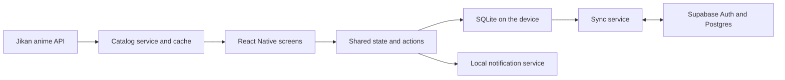

# Komori project plan

Meeting starting point, 19 October 2026. This describes the existing specification and proposed work split. It is not a record of new team decisions or completed features.

## Where we are

- Team: Yann Polini and Diego Traxler, Group G.
- Project: anime discovery and tracking, using the existing Komori specification dated 28 September.
- The five-page specification contains eight user stories with acceptance criteria. The PDF and editable source are in the course documents folder.
- Specification submission and lecturer approval still need to be confirmed. Course rules require approval before core implementation.
- The repository contains the official course starter and project setup. No Komori features have been implemented. A device run remains to be checked.
- The current course data, synced on 19 October, lists final submission for 9 November 2026 at 23:59 Vienna time and the presentation on 12 November.

## Proposed stack from the specification

| Part | Choice | What it does |
|---|---|---|
| Mobile app | React Native, Expo SDK 54, TypeScript | One app codebase. Android is required, iOS is optional |
| Navigation | Expo Router | Home, Discover and Lists tabs, plus Details and Account |
| Shared state | React Context and a reducer | Keeps watch status, lists, ratings and preferences consistent across screens |
| Anime catalog | Jikan v4 REST API | Search, title details, genres, catalog scores and release information |
| Local persistence | Expo SQLite | Saves app data and cached titles on the device, including offline edits |
| Accounts and cloud persistence | Supabase Auth and Postgres | Sign-in, private account data and syncing between devices |
| Session storage | Expo SecureStore | Stores session tokens securely on the device |
| Native feature | Expo local notifications | Optional reminders for saved titles, with permission handling |

Only the React Native/Expo/TypeScript starter is installed. The other choices are proposed in the specification and still need implementation and integration checks.

React Native uses React. Angular would mean changing the framework approach and checking course approval, rather than swapping a library. Node.js runs the development tools. This plan does not need a separate Node/Express backend. Supabase provides the cloud database and account APIs, while we still need to write the table migration, owner access policies and revision-checked save operation.

Public catalog data comes from Jikan. Personal lists, ratings and preferences belong to our app. SQLite and Postgres serve different purposes: SQLite keeps the current device usable offline, while Postgres stores the cloud copy. The sync service connects the two. Reminders are local to each device.

## Required course coverage

The app needs at least three screens, shared/reactive state, an external API, a meaningful native feature, offline persistence, tests and regular contributions from both students. AI functionality is not necessary for this plan. The reminder covers the native feature.

The final specification must link each core story to actual implementation. Keep those references and test evidence while building, rather than collecting everything at the end. Both students must understand the full submission and keep the README's AI Usage section accurate.

## Backlog and milestones

The eight feature cards follow the existing specification:

1. US-01: Discover anime.
2. US-02: Inspect and rate a title.
3. US-03: Maintain watch status.
4. US-04: Organize custom lists.
5. US-05: Receive explainable recommendations.
6. US-06: Use a personal account.
7. US-07: Set a watch reminder.
8. US-08: Keep working offline and recover safely.

Use three milestones to group the work: app foundation and catalog, personal data and offline sync, then recommendations, reminders and hand-in. These are proposed delivery stages. Only the final submission has a course deadline attached.

A Kanban board can start with these broad cards. Use Todo, In progress, Review and Done. Split a broad card into smaller tasks before starting it, keeping the user-story ID for traceability. For example, Discover can become navigation, Jikan client, search UI and error-state tasks. A card is Done when its agreed acceptance criteria and verification are complete. Agree on one owner per task and let the other teammate review it.

## Decisions for the meeting

1. Check whether the specification was submitted and approved. Find any lecturer feedback and confirm teammate repository access.
2. Read the eight stories together. Keep the proposed stack unless there is a concrete reason to change it. The account and offline-sync work is substantial, so explicitly agree whether this scope is realistic. Any reductions need a specification changelog entry and lecturer agreement as required.
3. Agree on the shared data model first: anime IDs, profile data, watch statuses, ratings, lists and storage interfaces.
4. Divide the first feature areas. One person could own Discover/Details and the Jikan integration, while the other owns watch status and custom lists. Both areas include UI and logic. Divide accounts/sync, reminders and recommendations as the next round of work rather than giving one person all storage and backend work.
5. Pick one small next task each, agree when to integrate, and review each other's changes. Leave GitHub assignments open until both people agree.

Start with a working route through the app: search for a real title, open its details, save it to a watch list, restart and find it again. This is an integration checkpoint, not a replacement for the remaining stories.

## Sources

- Komori Project Specification, 28 September 2026, sections 2.1-2.9, in the course documents.
- [Current Moodle project section](https://moodle.technikum-wien.at/course/view.php?id=34696#section-3) and [final submission](https://moodle.technikum-wien.at/mod/assign/view.php?id=2437646), checked through the connected course data on 19 October.
- [Supabase database overview](https://supabase.com/docs/guides/database/overview).
- [Expo SQLite](https://docs.expo.dev/versions/latest/sdk/sqlite/).
